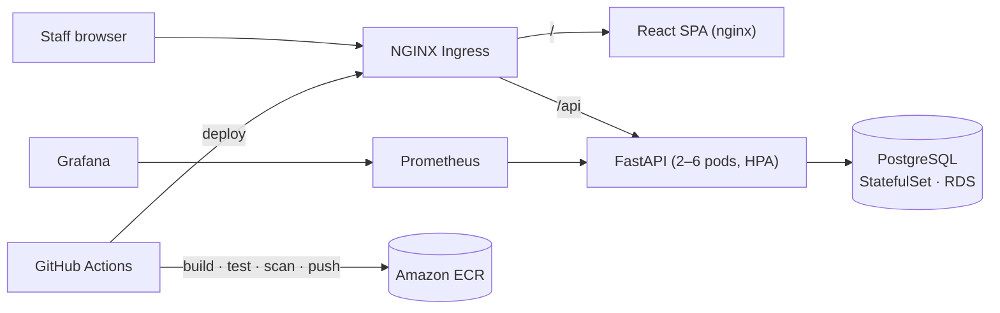

# MediCloud — Cloud-Native Smart Hospital Management System

[](https://github.com/Kuldeep-lang/MediCloud/actions/workflows/ci.yml)

MediCloud is a cloud-native Smart Hospital Management System built using React, FastAPI,
Docker, Kubernetes, Terraform, and Ansible, featuring automated deployment, infrastructure
provisioning, CI/CD, and real-time monitoring on AWS.

It is a hospital management system that runs as a working application: patients,
doctors, appointments, beds, pharmacy, billing and analytics. It is used to show the full
cloud and DevOps lifecycle:

- containerised with **Docker**
- orchestrated with **Kubernetes**
- provisioned on **AWS** with **Terraform**
- configured with **Ansible**
- delivered through **GitHub Actions**
- observed with **Prometheus and Grafana**

> All patient data is **synthetic**. Payments are **simulated**.

## Project status

| Phase | Scope | Status |
|---|---|---|
| 1 | Architecture and planning | ✅ Done |
| 2 | Full-stack application (FastAPI + React) | ✅ Done |
| 3 | Docker and Docker Compose | ✅ Done |
| 4 | Kubernetes (minikube) | ✅ Done |
| 5 | Terraform on AWS (VPC, EKS, ECR, RDS, IAM) | ✅ Applied and verified on AWS |
| 6 | Ansible (EC2 server + EKS bootstrap) | ✅ Verified, idempotent |
| 7 | CI/CD (GitHub Actions) | ✅ CI green on GitHub · CD deployed a new commit to EKS (OIDC, approval gate) |
| 8 | Monitoring (Prometheus, Grafana on EKS) | ✅ Verified, incl. an outage experiment |
| 9 | Final integration and demo guide | ✅ Full run from scratch: provision → configure → CI/CD deploy → destroy |

## Quick start (Docker Compose)

Requires only Docker Desktop.

```powershell
Copy-Item .env.example .env      # then replace every "change-me" value
docker compose up --build
```

Open **http://localhost:8080**. API docs are at **http://localhost:8080/api/docs**.

| Task | Command |
|---|---|
| Stop (keep data) | `docker compose stop`, or `docker compose down` |
| Start again | `docker compose up -d` |
| Restart | `docker compose restart` |
| Logs | `docker compose logs -f backend` |
| Reset the database | `docker compose down -v` |

Full operations guide, image design and security scan results:
**[docs/deployment.md](docs/deployment.md)**. Problems:
**[docs/troubleshooting.md](docs/troubleshooting.md)**.

## AWS (the deployment target)

The full environment is built at the start of a work session and destroyed at the end.
It costs about **US$0.46/hour**, roughly $2 a session. Prerequisites are AWS CLI
credentials, Docker Desktop and Git Bash.

```bash
ansible/run.sh init                                   # once: SSH key + vault
scripts/app-host-access.sh                            # allow SSH from your current IP
terraform -chdir=terraform init
terraform -chdir=terraform plan -out tfplan           # review
terraform -chdir=terraform apply tfplan               # ~20 min, starts billing
INGRESS_MODE=port-forward scripts/eks-deploy.sh       # images -> ECR, app -> EKS
INGRESS_MODE=port-forward ansible/run.sh playbook.yml # EC2 server, EKS bootstrap, monitoring
```

| Open | How |
|---|---|
| App on EKS | `kubectl port-forward -n nginx-ingress svc/nginx-ingress 8081:80`, then http://medicloud.localhost:8081 |
| App on the EC2 server | `http://$(terraform -chdir=terraform output -raw app_host_public_ip)` |
| Grafana | `kubectl port-forward -n medicloud-monitoring svc/grafana 3000:3000`, then http://localhost:3000 |

**End every session with `scripts/aws-teardown.sh`.** It deletes everything and then
checks that nothing billable is left.

Runbook, costs, Free-plan constraints and verification results:
**[docs/deployment.md §3–6](docs/deployment.md#3-aws-terraform--eks)**. A scripted
15-minute presentation: **[docs/demo-guide.md](docs/demo-guide.md)**.

## Kubernetes (minikube)

```powershell
minikube start --driver=docker --cpus=4 --memory=5g --cni=calico --addons=metrics-server
kubectl apply -k k8s/ingress-controller                     # F5 NGINX Ingress Controller v5.7.0
docker compose build; minikube image load medicloud-backend:local medicloud-frontend:local
python scripts/k8s_secrets.py                               # git-ignored k8s/01-secrets.yaml
kubectl apply -f k8s/
kubectl port-forward -n nginx-ingress svc/nginx-ingress 8081:80   # keep open
```

Open **http://medicloud.localhost:8081**. Then try:

- `kubectl get pods -n medicloud`
- `kubectl get hpa -n medicloud`
- `kubectl scale deployment/frontend --replicas=3 -n medicloud`

The runbook, autoscaling demo and verification results (zero-downtime rollout, HPA 2 → 6 → 2,
enforced NetworkPolicies, rate limits) are in
[docs/deployment.md §2](docs/deployment.md#2-kubernetes-minikube).

## Development mode (hot reload)

Run each piece directly to get instant reloads while coding. Commands below are for
**PowerShell on Windows**. On macOS or Linux, use `.venv/bin/` instead of `.venv\Scripts\`.

**Prerequisites:** Docker Desktop running, Python 3.12+, Node.js 22+.

**1. Start PostgreSQL 17 in a throwaway container**

First check whether it already exists (`docker ps -a --filter name=medicloud-dev-pg`).
If it does, run `docker start medicloud-dev-pg` and skip to step 2. Otherwise create it.
Keep the command on **one line**, which works in PowerShell, cmd and bash alike:

```powershell
docker run -d --name medicloud-dev-pg -e POSTGRES_USER=medicloud -e POSTGRES_PASSWORD=devpassword -e POSTGRES_DB=medicloud -p 127.0.0.1:5433:5432 postgres:17-alpine
docker exec medicloud-dev-pg psql -U medicloud -c "CREATE DATABASE medicloud_test"
```

The second command creates the separate database used by the test suite.

**2. Backend: FastAPI on http://127.0.0.1:8000** (API docs at `/api/docs`)

```powershell
cd backend
python -m venv .venv
.venv\Scripts\python -m pip install -r requirements-dev.txt
Copy-Item .env.example .env        # then set JWT_SECRET_KEY and SEED_DEMO_PASSWORD
.venv\Scripts\python -m app.db.prestart          # migrations + synthetic demo data
.venv\Scripts\uvicorn app.main:app --host 127.0.0.1 --port 8000
```

**3. Frontend: React on http://localhost:5173** (in a second terminal)

```powershell
cd frontend
npm install
npm run dev
```

**Sign in** with one of the demo accounts. The password is your `SEED_DEMO_PASSWORD`.

| Email | Role |
|---|---|
| `admin@medicloud.demo` | Administrator: everything, including revenue and monitoring |
| `doctor@medicloud.demo` | Doctor: own appointments, prescriptions, clinical history |
| `reception@medicloud.demo` | Receptionist: patients, booking, beds, billing |
| `pharmacy@medicloud.demo` | Pharmacist: inventory, dispensing, stock alerts |

### Tests and linting

```powershell
cd backend
.venv\Scripts\python -m pytest --cov=app    # 122 tests against real PostgreSQL (medicloud_test)
.venv\Scripts\ruff check app tests

cd ..\frontend
npm test          # 28 tests: components, routing/RBAC, API integration (MSW)
npm run lint
npm run build
```

### Stop and clean up

```powershell
docker stop medicloud-dev-pg     # keeps data; `docker start medicloud-dev-pg` resumes
docker rm -f medicloud-dev-pg    # deletes the dev database entirely
```

## Architecture at a glance



Full design: **[docs/architecture.md](docs/architecture.md)**
Phase-by-phase plan: **[docs/implementation-plan.md](docs/implementation-plan.md)**

## Technology stack

| Area | Technologies |
|---|---|
| Frontend | React, Vite, Tailwind CSS, Recharts, Axios |
| Backend | Python 3.13, FastAPI, SQLAlchemy 2, Pydantic v2, Alembic, JWT, Argon2id |
| Database | PostgreSQL 17 |
| Containers | Docker (multi-stage, non-root), Docker Compose |
| Orchestration | Kubernetes (minikube locally, Amazon EKS), NGINX Ingress, HPA |
| Infrastructure | Terraform: VPC, subnets, NAT, IAM, EKS, ECR, RDS. S3 remote state with native locking. |
| Configuration | Ansible roles, ansible-vault |
| CI/CD | GitHub Actions, Trivy, OIDC to AWS |
| Observability | Prometheus, Grafana, kube-state-metrics, metrics-server |

## Repository layout

```
.
├── backend/            FastAPI app (api, core, db, models, schemas, services), Alembic, tests
├── frontend/           React + Vite SPA, nginx config template
├── docker-compose.yml  Local stack: docker compose up --build
├── k8s/                Numbered manifests, ingress-controller/ (local + eks), overlays/eks, tools/
├── terraform/          Root stack, modules/ (vpc, security-groups, iam, eks, ecr, rds, app-host), bootstrap/
├── ansible/            Control-node Dockerfile, run.sh, playbook.yml, dynamic inventory, roles/
├── monitoring/         Prometheus config + rules, Grafana provisioning + dashboard, k8s/ manifests
├── .github/workflows/  ci.yml, cd.yml
├── scripts/            eks-deploy, aws-teardown, aws-leftovers, app-host-access, k8s_secrets
└── docs/               architecture, implementation plan, deployment, troubleshooting, demo guide
```

## Cost and safety

- **Local for development.** Docker Compose and minikube cost nothing.
- **AWS per session.** About $0.46/hour, paid from credits on a Free-plan account. Every
  `apply` is reviewed first, and `scripts/aws-teardown.sh` plus `scripts/aws-leftovers.sh`
  end each session.
- **Secrets are never committed.** The following are all git-ignored, and CI scans the
  history with gitleaks:
  - `.env` files and the Kubernetes Secret file;
  - Terraform state, plans and tfvars;
  - the Ansible vault.
- **No long-lived AWS keys in CI.** GitHub Actions assumes an IAM role through OIDC.
