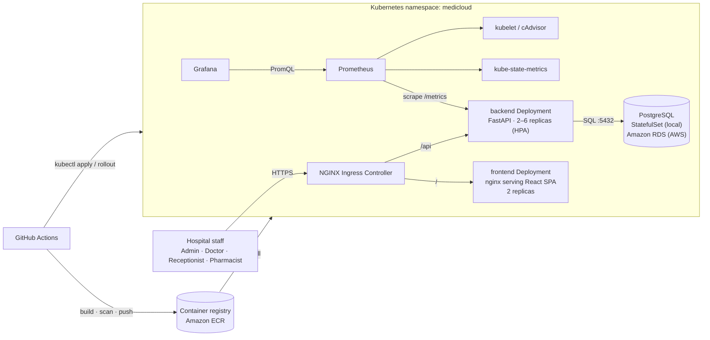
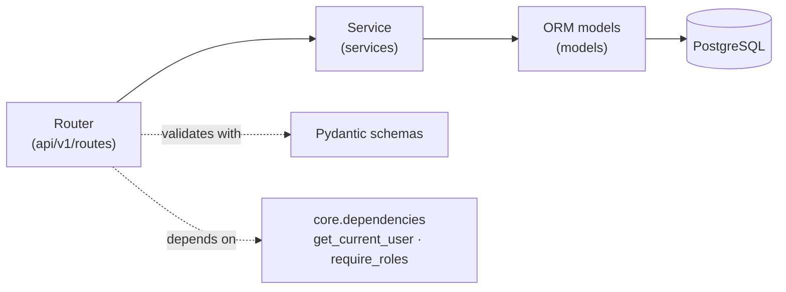
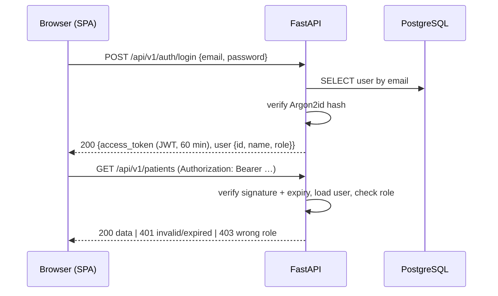
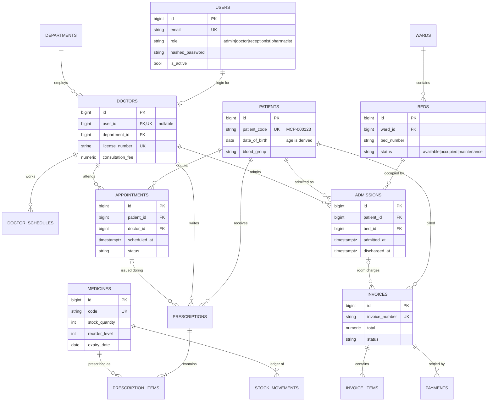
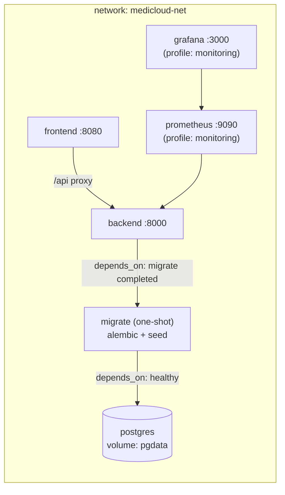
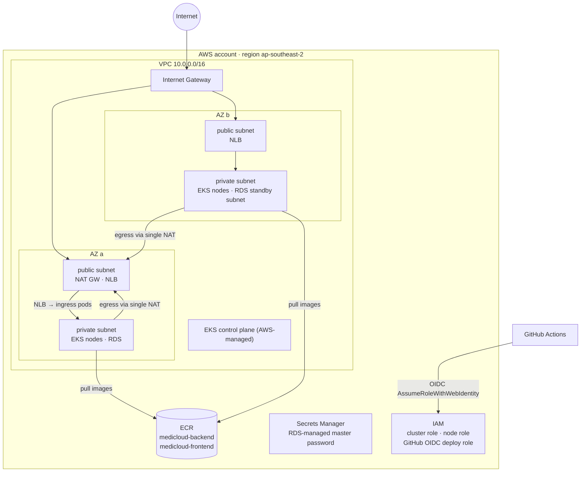
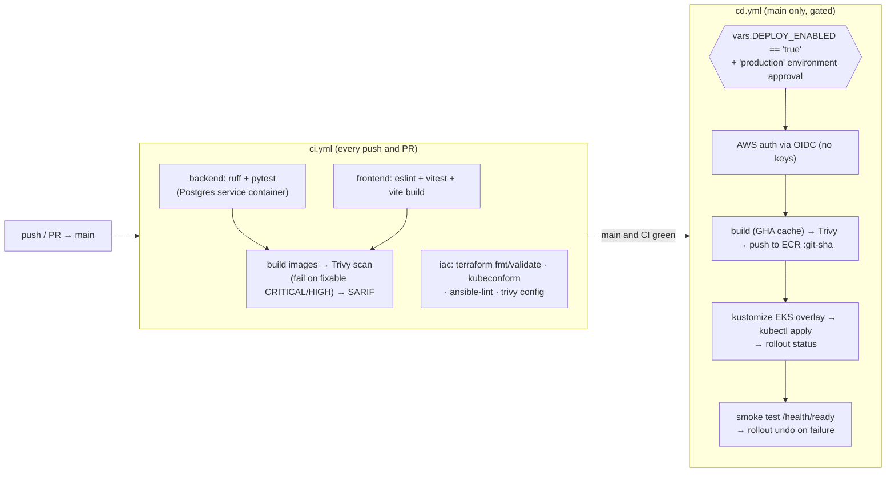

# MediCloud — Architecture

> **Status:** Phases 1–6 and 8 implemented and verified, on AWS from Phase 5 on. Phase 7
> (CI/CD) is written and dry-run locally; it runs once the repository is on GitHub.
> Decisions made during implementation are in [§15](#15-decision-log) (D16 onwards). Anything that changed during implementation is recorded in
> [§15 Decision log](#15-decision-log) (D16 onwards).

MediCloud is a hospital management system built to show how a real application
is containerised, deployed, automated, scaled, monitored and managed with cloud
and DevOps tooling. The hospital features are real and work end to end. The main
subject, though, is the delivery platform around them.

**Ground rules**

- **AWS is the target; local is for development.** Docker Compose and minikube were used
  to build and verify the stack (Phases 3–4). From Phase 5 on, deployment, configuration,
  CI/CD and monitoring target AWS (D37). The AWS environment is created for each work
  session and destroyed at the end, and each `apply` needs explicit cost approval.
- **Synthetic data only.** No real patient information, ever.
- **Simulated payments only.** No payment gateway integration.
- **No secrets in git.** `.env` files, Kubernetes Secret files, Terraform state and
  Ansible vault passwords are all git-ignored.

---

## Contents

1. [System context](#1-system-context)
2. [Technology stack](#2-technology-stack)
3. [Application architecture](#3-application-architecture)
4. [Authentication and authorisation](#4-authentication-and-authorisation)
5. [Data architecture](#5-data-architecture)
6. [API surface](#6-api-surface)
7. [Runtime environments](#7-runtime-environments)
8. [Containers (Docker)](#8-containers-docker)
9. [Kubernetes design](#9-kubernetes-design)
10. [AWS infrastructure (Terraform)](#10-aws-infrastructure-terraform)
11. [Configuration management (Ansible)](#11-configuration-management-ansible)
12. [CI/CD (GitHub Actions)](#12-cicd-github-actions)
13. [Observability](#13-observability)
14. [Security summary](#14-security-summary)
15. [Decision log](#15-decision-log)
16. [Known limitations](#16-known-limitations)

---

## 1. System context



The browser talks to **one origin**. Requests under `/api` go to the backend and
everything else goes to the frontend. `/metrics` is never routed through the
Ingress, so Prometheus scrapes it inside the cluster and the public can't reach it.

---

## 2. Technology stack

Exact library versions are pinned in `backend/requirements.txt` and `frontend/package-lock.json`.
The table below fixes only the versions that drive architecture.

Phase 2 resolved these versions (current stable, November 2026):

| Side | Versions |
|---|---|
| Backend | FastAPI 0.162, Starlette 1.10, SQLAlchemy 2.1, Pydantic 2.14, Alembic 1.20, psycopg 3.3, PyJWT 2.15, pwdlib 0.3 |
| Frontend | React 19.3, React Router 8.5, Recharts 3.10, Vite 8.3, Tailwind CSS 4.3, Vitest 5.1, MSW 3.0, ESLint 10 |

| Layer | Choice | Version target | Why |
|---|---|---|---|
| Frontend | React, Vite, Tailwind CSS v4, React Router, Recharts, Axios | Node 24 LTS for builds | Fast builds and a component model. Tailwind v4 uses the CSS-first config through the Vite plugin. |
| Frontend tests | Vitest, React Testing Library, MSW | — | Vitest shares the Vite config. MSW mocks the HTTP layer for API integration tests. |
| Backend | FastAPI, SQLAlchemy 2.0 (sync), Pydantic v2, Alembic | Python 3.13 | Typed request validation, automatic OpenAPI docs and a mature ORM with migrations. |
| DB driver | psycopg 3 | — | Current PostgreSQL driver with binary wheels. |
| Auth | PyJWT (HS256), pwdlib with Argon2id | — | Argon2id is the current OWASP-recommended password hash. passlib is unmaintained. |
| Metrics | prometheus-client (custom middleware) | — | Full control over labels: route template, method and status. |
| Database | PostgreSQL | 17, locally and on RDS | Same major version in every environment. |
| Containers | Docker multi-stage builds, Docker Compose | Docker 29, Compose v5 (verified on dev machine) | |
| Orchestration | Kubernetes: minikube locally, Amazon EKS on AWS | EKS version must be in standard support (§10.6) | |
| Ingress | NGINX Ingress Controller (see §9.6 for which one) | — | Required by the brief. Uses the portable `networking.k8s.io/v1` Ingress API. |
| IaC | Terraform with hand-written modules | ≥ 1.10 (1.16.5 installed) | 1.10+ supports S3-native state locking. |
| Config mgmt | Ansible (ansible-core) with roles | Runs in a container (no native Windows support) | |
| CI/CD | GitHub Actions | — | Uses OIDC to AWS, so no long-lived keys. |
| Security scanning | Trivy (images and IaC config) | Runs as a container locally | |
| Monitoring | Prometheus, Grafana, kube-state-metrics, metrics-server | — | |

---

## 3. Application architecture

### 3.1 Backend layering

```
backend/app/
├── main.py              app factory: middleware, routers, lifespan
├── core/                config (pydantic-settings), security (JWT, hashing),
│                        dependencies (current user, role guards), logging, metrics
├── db/                  engine/session, declarative base, prestart (migrate + seed)
├── models/              SQLAlchemy ORM models, one module per aggregate
├── schemas/             Pydantic request/response models (API contract)
├── services/            business rules and transactions (no HTTP concerns)
└── api/v1/routes/       thin routers: parse → authorise → call service → respond
```

Each layer has one job, and dependencies point downward only:



**Request lifecycle**

1. Middleware assigns a request ID, starts the latency timer and handles CORS.
2. The router dependency `get_current_user` decodes and verifies the JWT and loads the user.
3. `require_roles(...)` rejects the call with `403` if the role isn't allowed.
4. A Pydantic schema validates the body or query. Invalid input returns `422`.
5. The service runs inside one DB transaction. Multi-row operations such as bed
   allocation or medicine dispensing lock the rows they change with `SELECT … FOR UPDATE`.
6. The response is serialised through a response schema, so internal fields like
   `hashed_password` can never leak.
7. Middleware records `http_requests_total` and `http_request_duration_seconds`.

**One process per container.** Each backend container runs one uvicorn worker.
Kubernetes scales by adding replicas, not worker processes. This keeps HPA CPU
signals accurate, avoids prometheus-client multiprocess mode, and makes each pod a
cleanly replaceable unit.

### 3.2 Frontend architecture

```
frontend/src/
├── api/          axios instance + one module per resource (patients.js, …)
├── context/      AuthContext (token, user, role), ToastContext
├── components/   Sidebar, Topbar, DataTable, Modal, ConfirmDialog, StatCard,
│                 EmptyState, Spinner, ErrorState, charts/*
├── layouts/      AppLayout (navy sidebar + content), AuthLayout
├── pages/        Login, Dashboard, Patients, PatientDetail, Doctors, Appointments,
│                 Beds, Pharmacy, Billing, Monitoring, NotFound, Forbidden
├── routes/       route table + <ProtectedRoute roles={[...]}/>
├── hooks/        useApi (loading/error/data), useDebounce, usePagination
└── utils/        formatters (currency, dates), constants
```

- **Sidebar and routes are driven by role.** The same role map produces the menu and
  the route guards, so a user never sees a link they can't open.
- **Axios interceptors** attach `Authorization: Bearer <token>`. On `401` they clear the
  session and redirect to `/login`. On other errors they show a toast.
- **Every data view** has loading, empty and error states. Destructive actions use a
  confirmation dialog.
- **Visual style:** white and light-blue surfaces, dark navy sidebar, rounded cards with
  soft shadows, and minimal animation.

### 3.3 Same-origin routing

The SPA calls a relative base URL, `/api/v1`. Each environment routes that path to the
backend:

| Environment | Who routes `/api` → backend |
|---|---|
| Local dev (`npm run dev`) | Vite dev-server proxy → `localhost:8000` |
| Docker Compose | nginx in the frontend container → `backend:8000` |
| Kubernetes | Ingress rule `/api` → `backend` Service |

As a result, **one frontend image works in every environment**. No API URL is baked into
the JavaScript bundle at build time, and production has no CORS preflights. CORS is
still configured with an explicit allow-list for local development tools.

---

## 4. Authentication and authorisation

### 4.1 Flow



- **JWT claims:** `sub` (user ID), `role`, `iat`, `exp`. The token is signed with HS256
  using `JWT_SECRET_KEY`, which comes from the environment or a Kubernetes Secret.
- **Passwords:** hashed with Argon2id, with a minimum length policy enforced in the schema.
  Login errors are generic and never say which of email or password was wrong.
- **Token storage:** `sessionStorage`, cleared when the tab closes, with a short expiry and
  no refresh token. The trade-off is documented in §15. httpOnly cookies are safer against
  XSS but need CSRF handling. Our strict same-origin setup makes them a reasonable future step.
- **Enforcement lives in the backend.** Frontend role checks only shape the UI.

### 4.2 Role matrix

| Module | Admin | Doctor | Receptionist | Pharmacist |
|---|---|---|---|---|
| Dashboard | All KPIs incl. revenue | Clinical KPIs, own appointments today | Front-desk KPIs | Pharmacy KPIs |
| Users | Create / update / deactivate | — | — | — |
| Departments | Manage | Read | Read | — |
| Patients | Full | Read, medical history | Create / read / update | Read (basic, for dispensing) |
| Doctors | Add / update / deactivate, schedules | Read, edit own schedule | Read | — |
| Appointments | Full | Own: read, set status, diagnosis and notes | Book / reschedule / cancel / assign doctor | — |
| Beds and wards | Full, manage wards and beds | Read, discharge | Allocate / discharge | — |
| Pharmacy (medicines, stock) | Full | Read (to prescribe) | — | Full: add, update, restock |
| Prescriptions | Read | Create, read own | Read | Read, dispense |
| Billing | Full | — | Generate invoices, record payments | — |
| System monitoring | Full | — | — | — |

**Demo accounts.** The seed creates one account per role. Their password comes from
`SEED_DEMO_PASSWORD` and is never hardcoded.

---

## 5. Data architecture

### 5.1 Entity-relationship diagram



The 13 required tables are all present. Three more tables keep the design normalised:

- **`doctor_schedules`** stores weekly availability as one row per working block,
  instead of a JSON blob on `doctors`.
- **`prescription_items`** exists because a prescription has many medicines
  (a one-to-many relationship).
- **`stock_movements`** is an append-only stock ledger. It supports usage tracking and auditing.

### 5.2 Table specifications

Unless stated otherwise, every table has:

- `id BIGINT GENERATED ALWAYS AS IDENTITY PRIMARY KEY`
- `created_at TIMESTAMPTZ NOT NULL DEFAULT now()`
- `updated_at TIMESTAMPTZ NOT NULL DEFAULT now()` (maintained by the ORM)

PostgreSQL does **not** index foreign keys automatically, so every FK column used in
joins or filters gets an explicit index.

**users**

| Column | Type | Constraints |
|---|---|---|
| email | varchar(255) | NOT NULL, UNIQUE, stored lower-case |
| full_name | varchar(120) | NOT NULL |
| hashed_password | varchar(255) | NOT NULL |
| role | varchar(20) | NOT NULL, CHECK in (admin, doctor, receptionist, pharmacist), indexed |
| is_active | boolean | NOT NULL DEFAULT true |
| last_login_at | timestamptz | NULL |

**departments**

| Column | Type | Constraints |
|---|---|---|
| name | varchar(100) | NOT NULL, UNIQUE |
| code | varchar(10) | NOT NULL, UNIQUE (e.g. `CARD`) |
| description | text | |
| is_active | boolean | NOT NULL DEFAULT true |

**doctors**

| Column | Type | Constraints |
|---|---|---|
| user_id | bigint | FK → users ON DELETE SET NULL, UNIQUE, NULL |
| department_id | bigint | FK → departments ON DELETE RESTRICT, NOT NULL, indexed |
| first_name, last_name | varchar(60) | NOT NULL; composite index (last_name, first_name) |
| specialization | varchar(100) | NOT NULL, indexed |
| license_number | varchar(40) | NOT NULL, UNIQUE |
| email | varchar(255) | NOT NULL, UNIQUE |
| phone | varchar(20) | NOT NULL |
| consultation_fee | numeric(10,2) | NOT NULL, CHECK ≥ 0 |
| years_experience | smallint | CHECK ≥ 0 |
| is_active | boolean | NOT NULL DEFAULT true. Doctors are "removed" by deactivating, which keeps their history. |

**doctor_schedules**

| Column | Type | Constraints |
|---|---|---|
| doctor_id | bigint | FK → doctors ON DELETE CASCADE, NOT NULL |
| day_of_week | smallint | NOT NULL, CHECK 0–6 (0 = Monday) |
| start_time, end_time | time | NOT NULL, CHECK end_time > start_time |
| slot_minutes | smallint | NOT NULL DEFAULT 15, CHECK > 0 |
| — | — | UNIQUE (doctor_id, day_of_week, start_time) |

**patients**

| Column | Type | Constraints |
|---|---|---|
| patient_code | varchar(20) | NOT NULL, UNIQUE. This is the human-readable "Patient ID". |
| first_name, last_name | varchar(60) | NOT NULL; composite index; trigram GIN index for fuzzy name search |
| date_of_birth | date | NOT NULL. The API exposes a computed `age`. |
| gender | varchar(10) | NOT NULL, CHECK in (male, female, other) |
| phone | varchar(20) | NOT NULL, indexed |
| email | varchar(255) | NULL, indexed |
| address | text | |
| blood_group | varchar(3) | CHECK in (A+, A-, B+, B-, AB+, AB-, O+, O-) |
| emergency_contact_name | varchar(120) | |
| emergency_contact_phone | varchar(20) | |
| allergies | text | |

**appointments**

| Column | Type | Constraints |
|---|---|---|
| patient_id | bigint | FK → patients ON DELETE RESTRICT, NOT NULL |
| doctor_id | bigint | FK → doctors ON DELETE RESTRICT, NOT NULL |
| scheduled_at | timestamptz | NOT NULL, indexed |
| duration_minutes | smallint | NOT NULL DEFAULT 15, CHECK > 0 |
| status | varchar(15) | NOT NULL DEFAULT 'scheduled', CHECK in (scheduled, confirmed, completed, cancelled, no_show), indexed |
| reason | varchar(255) | |
| diagnosis, notes | text | Filled by the doctor. These feed the patient's medical history. |
| cancellation_reason | varchar(255) | |
| created_by | bigint | FK → users ON DELETE SET NULL |

Appointments also have these indexes:

- `(doctor_id, scheduled_at)` and `(patient_id, scheduled_at)`.
- A **partial unique index** on `(doctor_id, scheduled_at) WHERE status IN ('scheduled','confirmed')`.
  The database itself prevents double-booking a slot. The service layer additionally
  rejects overlapping durations.

**wards**

| Column | Type | Constraints |
|---|---|---|
| name | varchar(60) | NOT NULL, UNIQUE |
| ward_type | varchar(15) | NOT NULL, CHECK in (general, icu, private, emergency) |
| floor | smallint | |
| daily_rate | numeric(10,2) | NOT NULL, CHECK ≥ 0. Source of room charges. |

**beds**

| Column | Type | Constraints |
|---|---|---|
| ward_id | bigint | FK → wards ON DELETE RESTRICT, NOT NULL |
| bed_number | varchar(10) | NOT NULL, UNIQUE (ward_id, bed_number) |
| status | varchar(15) | NOT NULL DEFAULT 'available', CHECK in (available, occupied, maintenance); index (ward_id, status) |

**admissions**

| Column | Type | Constraints |
|---|---|---|
| patient_id | bigint | FK → patients, NOT NULL |
| bed_id | bigint | FK → beds, NOT NULL |
| admitting_doctor_id | bigint | FK → doctors ON DELETE SET NULL |
| admitted_at | timestamptz | NOT NULL DEFAULT now(), indexed (feeds the admission-trend chart) |
| discharged_at | timestamptz | NULL, CHECK discharged_at ≥ admitted_at |
| status | varchar(15) | NOT NULL, CHECK in (admitted, discharged), CHECK status/discharged_at consistent |
| reason | text | NOT NULL |
| discharge_summary | text | |

Two **partial unique indexes** enforce occupancy rules:

- `(bed_id) WHERE status='admitted'` means one patient per bed.
- `(patient_id) WHERE status='admitted'` means one active admission per patient.

`beds.status` is updated in the **same transaction** as the admission, with the bed row
locked `FOR UPDATE`, so the two can't drift apart under concurrent requests.

**medicines**

| Column | Type | Constraints |
|---|---|---|
| code | varchar(20) | NOT NULL, UNIQUE |
| name | varchar(120) | NOT NULL; trigram GIN index for search |
| generic_name, manufacturer | varchar(120) | |
| category | varchar(60) | indexed |
| dosage_form, strength | varchar(30) | e.g. tablet, 500 mg |
| unit_price | numeric(10,2) | NOT NULL, CHECK ≥ 0 |
| stock_quantity | integer | NOT NULL DEFAULT 0, CHECK ≥ 0 |
| reorder_level | integer | NOT NULL DEFAULT 10, CHECK ≥ 0. A low-stock alert fires when stock_quantity ≤ reorder_level. |
| batch_number | varchar(40) | |
| expiry_date | date | NOT NULL, indexed (expiring-soon alerts) |
| is_active | boolean | NOT NULL DEFAULT true |

**stock_movements** (append-only, no `updated_at`)

| Column | Type | Constraints |
|---|---|---|
| medicine_id | bigint | FK → medicines, NOT NULL; index (medicine_id, created_at DESC) |
| change_quantity | integer | NOT NULL, CHECK ≠ 0 (negative = stock out) |
| balance_after | integer | NOT NULL, CHECK ≥ 0 |
| reason | varchar(15) | NOT NULL, CHECK in (restock, dispense, adjustment, expired) |
| reference | varchar(60) | e.g. `prescription:42` |
| performed_by | bigint | FK → users ON DELETE SET NULL |

**prescriptions**

| Column | Type | Constraints |
|---|---|---|
| patient_id | bigint | FK → patients, NOT NULL, indexed |
| doctor_id | bigint | FK → doctors, NOT NULL, indexed |
| appointment_id | bigint | FK → appointments ON DELETE SET NULL, NULL |
| status | varchar(15) | NOT NULL DEFAULT 'pending', CHECK in (pending, dispensed, cancelled), indexed |
| notes | text | |
| dispensed_at | timestamptz | NULL |
| dispensed_by | bigint | FK → users ON DELETE SET NULL |

**prescription_items**

| Column | Type | Constraints |
|---|---|---|
| prescription_id | bigint | FK → prescriptions ON DELETE CASCADE, NOT NULL |
| medicine_id | bigint | FK → medicines ON DELETE RESTRICT, NOT NULL |
| dosage | varchar(60) | NOT NULL |
| frequency | varchar(60) | NOT NULL (e.g. `1-0-1`) |
| duration_days | smallint | CHECK > 0 |
| quantity | integer | NOT NULL, CHECK > 0 |
| instructions | varchar(255) | |
| — | — | UNIQUE (prescription_id, medicine_id) |

**invoices**

| Column | Type | Constraints |
|---|---|---|
| invoice_number | varchar(30) | NOT NULL, UNIQUE (e.g. `INV-2026-000123`) |
| patient_id | bigint | FK → patients ON DELETE RESTRICT, NOT NULL, indexed |
| admission_id | bigint | FK → admissions ON DELETE SET NULL, NULL |
| issued_at | timestamptz | NOT NULL DEFAULT now(), indexed |
| due_date | date | |
| subtotal, discount, tax, total | numeric(12,2) | NOT NULL, CHECK ≥ 0 |
| status | varchar(20) | NOT NULL, CHECK in (unpaid, partially_paid, paid, cancelled), indexed |
| created_by | bigint | FK → users ON DELETE SET NULL |

**invoice_items**

| Column | Type | Constraints |
|---|---|---|
| invoice_id | bigint | FK → invoices ON DELETE CASCADE, NOT NULL, indexed |
| item_type | varchar(15) | NOT NULL, CHECK in (consultation, medicine, room, diagnostic, other) |
| description | varchar(255) | NOT NULL |
| quantity | integer | NOT NULL, CHECK > 0 |
| unit_price | numeric(10,2) | NOT NULL, CHECK ≥ 0 |
| line_total | numeric(12,2) | `GENERATED ALWAYS AS (quantity * unit_price) STORED` |
| appointment_id, prescription_item_id, admission_id | bigint | FK, NULL, indexed. Traceability back to the billed source (consultation, medicine line or room stay). The service rejects sources already on a non-cancelled invoice, which prevents double billing. Cancelling an invoice makes its sources billable again. |

**payments** (simulated)

| Column | Type | Constraints |
|---|---|---|
| invoice_id | bigint | FK → invoices ON DELETE RESTRICT, NOT NULL, indexed |
| amount | numeric(12,2) | NOT NULL, CHECK > 0 |
| method | varchar(20) | NOT NULL, CHECK in (cash, card, upi, insurance, bank_transfer) |
| status | varchar(15) | NOT NULL, CHECK in (success, failed, refunded) |
| transaction_ref | varchar(40) | NOT NULL, UNIQUE (`SIM-…`, generated) |
| paid_at | timestamptz | NOT NULL DEFAULT now(), indexed (revenue queries) |
| received_by | bigint | FK → users ON DELETE SET NULL |

### 5.3 Data design decisions

| Decision | Reason |
|---|---|
| Store `date_of_birth`, not `age` | Age changes every year. Storing it would make the data wrong over time. The API returns a computed `age` field. |
| `varchar + CHECK` instead of native PG `ENUM` | Native enum values are awkward to change in Alembic migrations. CHECK constraints give the same integrity and are easy to alter. |
| `numeric` for all money | Floats lose precision with money. Currency is configurable (default INR). |
| `timestamptz` everywhere | All timestamps are stored in UTC. "Today" is calculated in `HOSPITAL_TIMEZONE`. |
| Soft-delete doctors and medicines (`is_active`) | Historical appointments, prescriptions and invoices must keep valid foreign keys. |
| Integrity rules in the database | Partial unique indexes for beds, admissions and double-booking hold even if a bug or race slips past the service layer. |
| Stock ledger plus a cached `stock_quantity` | The ledger gives auditability and usage charts. The cached column makes low-stock queries O(1). Both are updated in one transaction. |
| `BIGINT` identity keys plus human-readable codes | Simple joins and indexes. Patient and invoice codes are what staff see. |

### 5.4 Migrations and seed data

- **Alembic** owns the schema. The first migration creates every table, constraint and index,
  plus the `pg_trgm` extension. `pg_trgm` is a trusted extension on PostgreSQL 13+, so it
  works on RDS without superuser.
- **Prestart command** (`python -m app.db.prestart`):
  1. Waits for the database.
  2. Takes a **PostgreSQL advisory lock**.
  3. Runs `alembic upgrade head`.
  4. Seeds demo data if `SEED_DEMO_DATA=true` and the database is empty.
  5. Releases the lock.

  Because of the lock, the step is safe even when several backend replicas start at once.
  Compose runs it as a one-shot `migrate` service. Kubernetes runs it as an `initContainer`.
- **Seed data** is deterministic: Faker with a fixed random seed generates synthetic Indian
  names, addresses and phone numbers. Every run produces the same data. The volume is
  enough to make the charts meaningful:

| Item | Seeded volume (verified, about 6 s to seed) |
|---|---|
| Departments | 8 |
| Doctors | 16, each with weekly schedules (20-minute slots) |
| Patients | 120 |
| Appointments | ~1,750, covering the past 6 months and the next 2 weeks, with growth over time. No patient is double-booked. |
| Wards and beds | 5 wards (2 general, ICU, private, emergency), 80 beds: 33 occupied, 2 under maintenance |
| Admissions | ~105: 33 active, the rest discharged across 6 months |
| Medicines | 60. 8 are low on stock, 4 expire within 30 days, 2 are expired. Each has a consistent stock ledger. |
| Prescriptions | ~55% of completed visits, mostly dispensed, with ledger entries |
| Invoices | ~1,200, with mixed payment statuses and occasional simulated declines. Some recent visits are left unbilled to demo invoice generation. |

Demo accounts: `admin@`, `doctor@`, `reception@` and `pharmacy@medicloud.demo`. `.local` was
avoided because email validation rejects special-use domains.

---

## 6. API surface

The base path is `/api/v1`. OpenAPI docs are served at `/api/docs`. Docs can be disabled
in production with `ENABLE_DOCS=false`.

List endpoints accept `?page=&page_size=` (max 100) and return
`{items, total, page, page_size}`.

| Resource | Endpoints | Roles |
|---|---|---|
| Auth | `POST /auth/login` · `GET /auth/me` | public · any |
| Users | `GET/POST /users` · `PATCH /users/{id}` · `DELETE /users/{id}` (deactivate) | admin |
| Departments | `GET /departments` · `POST/PATCH/DELETE` | any · admin |
| Patients | `GET /patients?search=` · `POST` · `GET/PATCH /patients/{id}` · `GET /patients/{id}/history` (appointments, prescriptions, admissions) | §4.2 |
| Doctors | `GET /doctors?department_id=&specialization=` · `POST` · `GET/PATCH/DELETE /doctors/{id}` · `GET/PUT /doctors/{id}/schedules` · `GET /doctors/{id}/appointments` · `GET /doctors/{id}/availability?date=` | §4.2 |
| Appointments | `GET /appointments?date=&doctor_id=&status=` · `POST` · `GET/PATCH /appointments/{id}` (reschedule, reassign) · `POST /appointments/{id}/cancel` · `PATCH /appointments/{id}/status` | §4.2 |
| Wards and beds | `GET/POST /wards` · `GET /beds?ward_id=&status=` · `POST /beds` · `PATCH /beds/{id}` · `GET /beds/occupancy` | §4.2 |
| Admissions | `GET /admissions?status=` · `POST /admissions` (allocates bed atomically) · `POST /admissions/{id}/discharge` | §4.2 |
| Medicines | `GET /medicines?search=&low_stock=&expiring_within_days=` · `POST` · `PATCH/DELETE /medicines/{id}` · `POST /medicines/{id}/stock` · `GET /medicines/{id}/movements` · `GET /medicines/alerts` | §4.2 |
| Prescriptions | `GET /prescriptions` · `POST` · `GET /prescriptions/{id}` · `POST /prescriptions/{id}/dispense` (stock out + ledger, atomic) | §4.2 |
| Invoices | `GET /invoices?patient_id=&status=` · `POST` (manual items) · `POST /invoices/generate` (from unbilled consultations, dispensed medicines, room-days) · `GET /invoices/{id}` · `POST /invoices/{id}/cancel` | admin, receptionist |
| Payments | `POST /invoices/{id}/payments` (simulated) · `GET /payments` | admin, receptionist |
| Dashboard | `GET /dashboard/summary` · `/dashboard/admissions-trend?days=` · `/dashboard/appointment-stats` · `/dashboard/department-distribution` · `/dashboard/revenue?months=` | role-filtered |
| System | `GET /system/status` (version, pod name, uptime, DB latency, request counters) | admin |
| Probes (not under `/api`) | `GET /health/live` · `GET /health/ready` · `GET /metrics` | internal |

`/system/status` returns the **pod hostname** of the replica that served the request.
On the Monitoring page, refreshing shows different pods answering, which makes Service
load balancing across backend replicas visible during the demo.

---

## 7. Runtime environments

AWS EKS is the deployment target (D37). Its column is implemented in Terraform but not yet
applied.

| | Local dev | Docker Compose | minikube | AWS EKS (target) |
|---|---|---|---|---|
| Frontend | Vite dev server :5173 | nginx container → `localhost:8080` | Deployment ×2 | Deployment ×2 |
| Backend | `uvicorn --reload` :8000 | container, internal only (no host port) | Deployment, 2–6 replicas (HPA) | same |
| Database | Compose `postgres` service | `postgres:17-alpine` + named volume | StatefulSet + PVC | Amazon RDS in private subnets |
| Images | — | built locally | built locally, loaded into minikube | ECR, tagged with git SHA |
| Entry point | — | frontend nginx | NGINX Ingress (`minikube tunnel` or `minikube ip`) | NGINX Ingress behind an AWS NLB |
| Secrets | `.env` | `.env` | Secret from a git-ignored file / script | Secret built in CD from AWS Secrets Manager |
| Monitoring | — | optional `monitoring` profile (Prometheus + Grafana) | `monitoring/k8s/` manifests | same manifests |

---

## 8. Containers (Docker)

### 8.1 Images

| Image | Build stage | Runtime stage | Runs as | Health check |
|---|---|---|---|---|
| `medicloud-backend` (~350 MB) | `python:3.13-slim`: dependencies into a virtualenv, then pip removed | `python:3.13-slim` + copied venv. OS packages upgraded, **pip removed**, code root-owned and read-only, bytecode pre-compiled. | UID 10001 (non-root) | `GET /health/live` (Python urllib, so no curl needed) |
| `medicloud-frontend` (~100 MB) | `node:24-alpine`: `npm ci && npm run build` | `nginxinc/nginx-unprivileged:stable-alpine` (nginx 1.30) + `dist/`, OS packages upgraded | UID 101, listens on 8080 | `GET /healthz` served by nginx |

The frontend nginx config is an `envsubst` template. `BACKEND_UPSTREAM` changes per
environment without rebuilding; the filter limits substitution to two variables.

The template also provides:

- SPA fallback, gzip, and one-year caching for hashed assets, with `index.html` always revalidated.
- Security headers: CSP, `X-Frame-Options`, `nosniff`, `Referrer-Policy`, `Permissions-Policy`.
- **Runtime DNS re-resolution** (`resolver` plus a variable `proxy_pass`). nginx starts
  before the backend exists and follows it to a new IP after a recreate. This was verified
  by forcing a new IP.

Phase 3 verification results are in [deployment.md §1.6](deployment.md#16-security-scanning):

- 0 fixable vulnerabilities in either image.
- 0 vulnerabilities in the frontend image.
- Both Dockerfiles pass all 27 Trivy misconfiguration checks.

### 8.2 Compose topology



- The Compose file sits at the **repo root**, so `docker compose up --build` works exactly
  as the brief specifies. Its project name is fixed as `medicloud`.
- **Published to the host:** only the frontend, on `127.0.0.1:8080`. The backend and
  PostgreSQL are internal; Swagger is reached through the proxy at `/api/docs`. This mirrors
  the single Ingress entry point used in Kubernetes.
- **Container hardening:** `read_only` root filesystems (with `tmpfs` where writes are needed),
  `cap_drop: [ALL]`, `no-new-privileges`, and CPU/memory limits.
- **Startup order** is enforced by health checks plus `depends_on` conditions
  (`service_healthy`, `service_completed_successfully`).

---

## 9. Kubernetes design

### 9.1 Objects

| File | Objects | Key settings |
|---|---|---|
| `00-namespace.yaml` | Namespace `medicloud` | Pod Security Admission label `restricted` |
| `01-secrets.yaml` (git-ignored) | Secret `medicloud-secrets` | Created from `01-secrets.yaml.example` or `scripts/k8s-secrets`. DB credentials, `DATABASE_URL`, `JWT_SECRET_KEY` |
| `02-configmap.yaml` | ConfigMap `medicloud-config` | Non-secret settings: env name, CORS, log level, timezone |
| `03-postgres-statefulset.yaml` | StatefulSet + headless Service + `volumeClaimTemplates` (PVC) | Local demo only. Replaced by RDS on EKS. |
| `04-backend-deployment.yaml` | Deployment + ServiceAccount | 2 replicas, prestart `initContainer`, probes, resources |
| `05-frontend-deployment.yaml` | Deployment | 2 replicas, probes, resources |
| `06-services.yaml` | ClusterIP Services `backend`, `frontend` | Internal DNS: `backend.medicloud.svc.cluster.local` |
| `07-ingress.yaml` | Mergeable Ingresses: master plus 3 minions, host `medicloud.localhost` | `/` → frontend:8080, `/api` → backend:8000 (20 r/s per IP, burst 40), `/api/v1/auth/login` exact (5 r/min per IP, burst 5, returns 429) |
| `08-hpa.yaml` | HorizontalPodAutoscaler (autoscaling/v2) | backend: CPU 70%, min 2, max 6. Scales up 2 pods/30 s; scales down 1 pod/min after a 120 s stabilisation window. |
| `09-policies.yaml` | NetworkPolicies + PodDisruptionBudget | Default-deny ingress; ingress-controller → fe/be; be → postgres; Prometheus → be:8000. PDB: backend minAvailable 1 |

**Why the numeric prefixes?** `kubectl apply -f k8s/` reads files in lexical order, so the
Namespace must sort first.

**Secrets handling.** The template is named `.yaml.example` because kubectl only reads
`.yaml`, `.yml` and `.json` files. If it were a `.yaml` file, applying the folder would
create a Secret with placeholder values.

### 9.2 Health probes

| Probe | Endpoint | Checks | Effect when failing |
|---|---|---|---|
| Liveness | `/health/live` | Process responds. **No DB check.** | Container restarted |
| Readiness | `/health/ready` | `SELECT 1` against PostgreSQL | Pod removed from Service endpoints, so it gets no traffic |
| Startup (backend) | `/health/live` | Gives slow starts time before liveness applies | — |

The liveness probe deliberately ignores the database. If PostgreSQL goes down, restarting
every backend pod fixes nothing and causes a restart storm. Instead, readiness takes pods
out of rotation, and they come back on their own when the database recovers.

### 9.3 Scaling and rollouts

- **Rolling updates** use `maxSurge: 1, maxUnavailable: 0`. Combined with the readiness
  probe, an old pod is removed only after its replacement is serving, so deploys have
  zero downtime.
- **HPA** uses metrics-server CPU data. `k8s/tools/load-generator.yaml` is a busybox/hey pod,
  not auto-applied, that drives load so you can watch replicas grow from 2 toward 6 with
  `kubectl get hpa -n medicloud -w`.
- **Manual scaling:** `kubectl scale deployment/backend --replicas=4 -n medicloud`.
  Note that the HPA will reconcile back within its bounds. Scale the frontend freely,
  since it has no HPA.

### 9.4 Resource budget

| Workload | Requests (CPU / memory) | Limits (CPU / memory) |
|---|---|---|
| backend (per pod) | 100m / 192Mi | 500m / 512Mi |
| frontend (per pod) | 25m / 32Mi | 200m / 128Mi |
| postgres | 250m / 256Mi | 1 / 1Gi |
| prometheus · grafana · kube-state-metrics | 100m / 256Mi · 50m / 128Mi · 25m / 64Mi | 500m / 1Gi · 250m / 256Mi · 100m / 128Mi |

These fit a minikube node with 4 CPUs and about 5 GB of memory, which is sized for this
16 GB machine running Docker Desktop.

### 9.5 Pod security

All workloads run with:

- `runAsNonRoot: true` and a fixed UID
- `readOnlyRootFilesystem: true`, with `emptyDir` mounts where a temp dir is needed
- `allowPrivilegeEscalation: false` and `capabilities.drop: [ALL]`
- `seccompProfile: RuntimeDefault`
- `automountServiceAccountToken: false`

Together these satisfy the namespace's `restricted` Pod Security level.

NetworkPolicies need a CNI that enforces them. minikube's default CNI does not, so the
local cluster is started with `--cni=calico`. On EKS, the VPC CNI add-on is configured
with network-policy enforcement enabled.

### 9.6 Ingress controller

The brief asks for the **NGINX Ingress Controller**. Two different projects use that name:

| Project | Status (Nov 2026) |
|---|---|
| `kubernetes/ingress-nginx` (community, minikube's `ingress` addon) | **Retired in March 2026.** It gets no further releases or security fixes. The Kubernetes Steering and Security Response Committees advise migrating away. |
| `nginx/kubernetes-ingress` (F5 NGINX Ingress Controller, open source) | Actively maintained, and implements the same `networking.k8s.io/v1` Ingress API |

**Implemented (Phase 4):** F5's NGINX Ingress Controller **v5.7.0** (`ingressClassName: nginx`),
installed with `kubectl apply -k k8s/ingress-controller`. That Kustomization pins every
upstream manifest to the release tag and enables Prometheus metrics on port 9113.

v5.7.0 was released 2026-10-14. The newer v5.7.1 was only a week old at implementation
time, so it was deliberately not adopted yet: the Trivy incident (D23) showed that very
fresh releases carry supply-chain risk.

Access from the host on Windows uses `kubectl port-forward` to the controller, because
minikube's Docker-driver node IP isn't routable from Windows. The full runbook and test
results are in [deployment.md §2](deployment.md#2-kubernetes-minikube).

### 9.7 EKS overlay

On EKS the same base manifests are reused through a Kustomize overlay, `k8s/overlays/eks/`,
which makes three changes:

- Images point to ECR, tagged with the git SHA.
- The in-cluster PostgreSQL StatefulSet is removed, because the app uses RDS.
- The Namespace object is omitted, because it is created once by an admin or by Ansible.
  This lets the CD role stay namespace-scoped.

The overlay is rendered with
`kubectl kustomize --load-restrictor LoadRestrictionsNone k8s/overlays/eks | kubectl apply -f -`.
The flag was verified on kubectl 1.36.1. This keeps `kubectl apply -f k8s/` as the simple
local command while avoiding a second copy of every manifest.

---

## 10. AWS infrastructure (Terraform)

> **Status (Phase 5): applied and verified on AWS (2026-11-12/13).**
> - **Offline:** `terraform validate`, 22 mock-provider tests (7 modules plus a whole-stack
>   plan), TFLint, and
>   Trivy (142 passed, 0 failed) are all clean.
> - **On AWS:** 49 resources (+11 for the EC2 app server). The app runs on EKS against RDS
>   over TLS 1.3, and `terraform plan` shows no drift.
> - **Free-plan adjustments:** `c7i-flex.large` nodes (D38) and 1-day RDS backups (D40).
> - **No load balancer:** the account can't create one yet, so ingress uses port-forward mode
>   (D39).
>
> Runbook, costs and results: [deployment.md §3](deployment.md#3-aws-terraform--eks).

### 10.1 Topology



### 10.2 Modules

| Module | Resources | Notes |
|---|---|---|
| `vpc` | VPC, 2 public + 2 private subnets across 2 AZs, IGW, **one** NAT gateway + EIP, route tables | Subnets carry the `kubernetes.io/role/elb` and `internal-elb` tags for load-balancer discovery. Private subnets are larger (/20) because the VPC CNI gives each pod a VPC IP. |
| `security-groups` | RDS SG, extra node SG rules | RDS accepts 5432 **only** from the EKS cluster/node security group |
| `iam` | EKS cluster role, node role, GitHub OIDC provider + deploy role | Uses AWS-managed policies scoped to purpose (e.g. `AmazonEC2ContainerRegistryPullOnly` for nodes). The deploy role can push to the two ECR repos only and describe one cluster. |
| `eks` | EKS cluster (access-entry auth mode), managed node group, add-ons (vpc-cni with network policy, coredns, kube-proxy, metrics-server), access entries | The API endpoint's public access is limited to `allowed_cidrs`. The CD role is mapped to `AmazonEKSEditPolicy` **scoped to the `medicloud` namespace**. |
| `ecr` | 2 repositories | Immutable tags, scan on push, AES-256 encryption, lifecycle keeps the last 10 images, `force_delete` so teardown is clean |
| `rds` | DB subnet group (private), parameter group (`rds.force_ssl=1`), PostgreSQL 17 instance | `db.t4g.micro`, 20 GB gp3, encrypted, `publicly_accessible=false`, single-AZ, `manage_master_user_password=true` so the password lives in Secrets Manager and **not in Terraform state** |

Root files follow the requested layout: `main.tf`, `variables.tf`, `outputs.tf`, `versions.tf`,
`terraform.tfvars.example` and `backend.tf.example`.

### 10.3 Remote state

`terraform/bootstrap/` is a tiny configuration with local state. It creates the S3 state
bucket with versioning, SSE, public access fully blocked and a TLS-only bucket policy.
The main stack then uses:

```hcl
backend "s3" {
  bucket       = "<your-state-bucket>"
  key          = "medicloud/terraform.tfstate"
  region       = "ap-southeast-2"
  encrypt      = true
  use_lockfile = true   # S3-native locking (Terraform ≥ 1.10); DynamoDB locking is deprecated
}
```

### 10.4 Credentials

Credentials are never hardcoded in Terraform.

- **Locally:** the AWS CLI profile or SSO session.
- **In CI:** short-lived credentials through GitHub OIDC (`aws-actions/configure-aws-credentials`).
  No access keys are stored in GitHub.

### 10.5 Cost estimate

These are the Phase 1 estimates for **ap-southeast-2 (Sydney)**. Phase 5 verified them
against AWS's price list (≈ $0.35/hour), then moved the nodes to c7i-flex.large for the
Free-plan account (D38). The current total is **≈ $0.47/hour**, itemised in
[deployment.md §3.2](deployment.md#32-cost-estimate). EKS and NAT Gateway have no free
allowance, but AWS credits can pay for them.

| Resource | Configuration | ≈ USD / hour | ≈ USD / day |
|---|---|---|---|
| EKS control plane | 1 cluster, standard support | 0.10 | 2.40 |
| Worker nodes | 2 × t3.medium, on-demand | ~0.11 | ~2.55 |
| NAT Gateway | 1, plus ~$0.06 per GB processed | ~0.06 | ~1.45 |
| RDS PostgreSQL | db.t4g.micro, single-AZ, 20 GB gp3 | ~0.03 | ~0.70 |
| Network Load Balancer | for the ingress controller | ~0.03 | ~0.65 |
| Public IPv4, EBS, ECR, Secrets Manager, CloudWatch | small | — | ~0.40 |
| **Total** | | **~0.33** | **~$8 / day (~$240 / month if left running)** |

**Plan for cost:** provision → demo → `terraform destroy` on the same day. A 3-hour demo
costs roughly **$1–2**. To cut costs further:

- Use Spot nodes (`node_capacity_type = "SPOT"`), which saves about 60–70% on nodes.
- Shrink to 1 node for a quick demo.

**Avoid the extended-support trap.** An EKS version that falls out of standard support costs
**6× more** ($0.60 instead of $0.10 per hour). Phase 5 selected **1.37**, which is in standard support until about December 2027. It is the
same version the minikube cluster ran in Phase 4. `upgrade_policy { support_type = "STANDARD" }`
makes EKS upgrade the cluster instead of silently switching to extended-support billing.

---

## 11. Configuration management (Ansible)

> **Status (Phase 6): implemented and verified.**
> - **Target:** an Ubuntu 24.04 EC2 VM (D41) plus the EKS cluster.
> - **Idempotency:** a rerun after the first complete run reports `changed=0` on both
>   targets.
> - **Roles:** the design below, plus `monitoring_stack` (D45).
>
> Commands and results: [deployment.md §4](deployment.md#4-configuration-management-ansible).

Ansible does not run natively on Windows. The **control node is a container**
(`ansible/Dockerfile`: ansible-core, ansible-lint, and the collections `community.docker`,
`kubernetes.core` and `ansible.posix`). CI uses the same image, so local and pipeline runs
behave identically.

| Role | Target | What it does |
|---|---|---|
| `common` | Linux hosts | Base packages, timezone, `medicloud` system user, directory layout |
| `docker` | Linux hosts | Docker CE from the official apt repo, compose plugin, templated `daemon.json` (log rotation, live-restore). A handler restarts Docker. |
| `monitoring_agent` | Linux hosts | node_exporter (checksum-verified) as a systemd service, with a templated unit and handler |
| `app_config` | Linux hosts | `/opt/medicloud`, templated `.env` (mode 0600, secrets from **ansible-vault**), Compose and Prometheus config |
| `app_deploy` | Linux hosts | `community.docker.docker_compose_v2` up. This is the single-VM deployment mode. |
| `k8s_deploy` | localhost → cluster | Creates the namespace, Secret (from vault) and ingress controller, then applies the manifests and waits for rollouts. This orchestrates Kubernetes; it does not manage individual containers. |
| `healthcheck` | either | `uri` checks against `/health/ready` and the frontend, with retries and assertions |

`playbook.yml` holds two tagged plays: `host` (hosts: `app_servers`) and `k8s`
(hosts: `localhost`).

**Testing:**

- `ansible-playbook --syntax-check`, `ansible-lint`, and `--check --diff`.
- A real run against an **Ubuntu 24.04 EC2 instance** (D37), created and destroyed with the
  session's AWS environment. The `k8s` play targets the EKS cluster.

---

## 12. CI/CD (GitHub Actions)

> **Status (Phase 7):** CI runs green on GitHub (all 6 jobs). CD is written and gated, and
> is verified end to end in an AWS session.
>
> **Changes from the original design:**
> - CD reads the environment values from the cluster that Ansible bootstrapped (D42).
> - The smoke test uses a port-forward to the frontend Service, so it works with or without
>   a load balancer (D39).
> - A failed deployment is rolled back automatically.
>
> Setup: [deployment.md §5](deployment.md#5-cicd-github-actions).



- **CI and CD are separate workflows.** CI runs on every push and PR. CD runs via
  `workflow_run` only after CI succeeds on `main`.
- **Two gates protect your AWS bill.** The repository variable `DEPLOY_ENABLED` and a
  GitHub Environment with required reviewers mean nothing deploys while the cluster
  doesn't exist, and nothing deploys without a click.
- **Images** are tagged with the immutable git SHA. The CD build reuses CI's GitHub Actions
  layer cache, so the image it pushes is built from the same layers that were scanned.
- **Configuration in GitHub:**

| Kind | Names | Notes |
|---|---|---|
| Secret | `AWS_ROLE_ARN` | |
| Variables | `AWS_REGION`, `EKS_CLUSTER_NAME`, `DEPLOY_ENABLED` | |
| Optional secrets | `DOCKERHUB_USERNAME`, `DOCKERHUB_TOKEN` | Only if you choose Docker Hub |

  No secret values appear in workflow files.

---

## 13. Observability

> **Status (Phase 8): implemented and verified on EKS.**
> - **Targets:** all 8 Prometheus targets are up, including the EC2 node_exporter.
> - **Rules:** all 9 are loaded.
> - **Dashboard:** every panel shows data.
> - **Outage test:** a database outage fired `DatabaseDown` and moved the error and latency
>   panels; the alerts cleared after recovery.
>
> The Compose `monitoring` profile in §13.2 was not built: the project moved to AWS (D37).
> Details: [deployment.md §6](deployment.md#6-monitoring-prometheus--grafana-on-eks).

### 13.1 Signals

| Requirement | Metric / source |
|---|---|
| API request count | `http_requests_total{method, route, status}` (route = path template, so label cardinality stays bounded) |
| API response time | `http_request_duration_seconds` histogram, used for p50/p95/p99 |
| HTTP error rate | `rate(http_requests_total{status=~"5.."}) / rate(http_requests_total)` |
| In-flight requests | `http_requests_in_progress` |
| Database connectivity | `medicloud_db_up`, `medicloud_db_ping_seconds` (checked on scrape) |
| Application availability | Prometheus `up{job="medicloud-backend"}` + `kube_deployment_status_replicas_available` |
| CPU / memory | cAdvisor `container_cpu_usage_seconds_total`, `container_memory_working_set_bytes` |
| Pod health / restarts | kube-state-metrics `kube_pod_status_ready`, `kube_pod_container_status_restarts_total` |
| Autoscaling | `kube_horizontalpodautoscaler_status_current_replicas` |
| Build info | `medicloud_build_info{version, commit}` |
| Business gauges | `medicloud_beds_occupied`, `medicloud_appointments_today` |

### 13.2 Collection

- **Discovery in Kubernetes.** Prometheus uses `kubernetes_sd_configs`. Backend pods opt in
  with `prometheus.io/scrape: "true"` annotations. Prometheus gets a read-only
  ClusterRole for discovery.
- **Container metrics.** cAdvisor is scraped through the API server's node proxy.
- **Compose.** The `monitoring` profile scrapes `backend:8000/metrics` statically.
- **Alert rules** (visible in the Prometheus UI):

| Alert | Fires when |
|---|---|
| BackendDown | Backend targets are down |
| HighErrorRate | Error rate > 5% for 5 min |
| HighLatencyP95 | p95 latency > 1 s |
| PodRestartLoop | A pod keeps restarting |
| DatabaseDown | The database is unreachable |

### 13.3 Grafana

The datasource and the **MediCloud Overview** dashboard are provisioned from files, so
nothing is configured by hand. The dashboard has five rows:

1. Application health: availability, DB status, build version.
2. API performance: requests/sec, p50/p95/p99 latency.
3. Requests and errors: by status and by route.
4. Kubernetes resources: CPU and memory per pod, restarts, ready pods, HPA replicas.
5. Business gauges.

Local access:

| Environment | How |
|---|---|
| Compose | `http://localhost:3000` |
| Kubernetes | `kubectl port-forward svc/grafana 3000:3000 -n medicloud-monitoring` |

The in-app **System Monitoring** page shows `/system/status` data and links to Grafana.

### 13.4 Why hand-written manifests

The alternative was the `kube-prometheus-stack` Helm chart. The hand-written manifests in
`monitoring/k8s/` (Prometheus, kube-state-metrics, Grafana) were chosen because:

- every line can be explained in a project viva;
- no Helm dependency is needed;
- the footprint is small enough for minikube.

The Helm chart is noted as the production upgrade path.

---

## 14. Security summary

| Area | Control |
|---|---|
| Secrets | `.env` (git-ignored) locally; K8s Secret from a git-ignored file; RDS password in Secrets Manager; GitHub OIDC instead of AWS keys; ansible-vault |
| Identity | Argon2id password hashing; JWT with expiry; generic login errors |
| Authorisation | Role checks on every endpoint in the backend; UI guards are cosmetic |
| Input | Pydantic validation (types, lengths, enums, email); ORM parameterised queries (no string SQL) |
| Transport | TLS-terminating Ingress on EKS; RDS `force_ssl`; same-origin with no wildcard CORS |
| Containers | Non-root, read-only root filesystem, dropped capabilities, minimal base images, Trivy-scanned |
| Cluster | Namespace Pod Security `restricted`; NetworkPolicies (DB reachable only from the backend); namespace-scoped CD permissions |
| Cloud | RDS and nodes in private subnets; SG-to-SG rules; least-privilege IAM; encrypted storage; EKS endpoint public but IAM-authenticated (D37), narrowable by CIDR |
| Data | Synthetic data only; no PII from real people |

---

## 15. Decision log

| # | Decision | Alternatives considered | Rationale |
|---|---|---|---|
| D1 | Repo root = project root; Compose file at root | `docker/docker-compose.yml` as in the brief | So that `docker compose up --build` works from the root exactly as required. The planned `docker/` folder was dropped in Phase 3 because no init scripts were needed. |
| D2 | Sync SQLAlchemy + psycopg 3 | Async SQLAlchemy + asyncpg | Simpler code, migrations and tests. FastAPI runs sync endpoints in a threadpool, and we scale with replicas. |
| D3 | One uvicorn process per container | Gunicorn with N workers | Accurate HPA signals, simple Prometheus metrics, Kubernetes-native scaling |
| D4 | Same-origin `/api` routing | Absolute API URL baked in at build time | One image for all environments; no CORS in production |
| D5 | Migrations under an advisory lock, as a one-shot service / initContainer | Migrations in app startup; separate Job | Safe with N replicas; works with a plain `kubectl apply -f k8s/` |
| D6 | `varchar + CHECK` enums | Native PostgreSQL ENUM | Easier schema evolution in Alembic |
| D7 | Bearer token in `sessionStorage` | httpOnly cookie + CSRF token | Simpler for an academic scope; documented as a known trade-off |
| D8 | F5 NGINX Ingress Controller | Community ingress-nginx (retired), Traefik, Gateway API | Satisfies "NGINX Ingress" and is still maintained |
| D9 | Hand-written monitoring manifests | kube-prometheus-stack Helm chart | Explainable, light, no Helm dependency |
| D10 | Own Terraform modules | `terraform-aws-modules/*` | Shows understanding of every resource |
| D11 | Single NAT gateway, 2 AZs, 2 nodes (t3.medium, later c7i-flex.large per D38), db.t4g.micro single-AZ | NAT per AZ, Multi-AZ RDS | Cost-conscious academic setup; the HA upgrade path is documented |
| D12 | GitHub OIDC → IAM role | IAM user access keys in GitHub secrets | No long-lived credentials |
| D13 | CD gated by `DEPLOY_ENABLED` + environment approval | Always deploy on merge | The cluster is short-lived; prevents failed runs and surprise deploys |
| D14 | Postgres StatefulSet locally, RDS on AWS | StatefulSet everywhere | Managed backups, patching and encryption in the cloud; StatefulSet still demonstrated locally |
| D15 | Ansible control node in a container | WSL install; native Windows (unsupported) | Reproducible, identical in CI |
| D16 | Metrics route label rebuilt from the matched `path_params` after routing | Scanning `app.routes` for the template | FastAPI 0.16x includes routers lazily (`_IncludedRouter`), so templates are no longer on `app.routes`. The new approach doesn't depend on framework internals and still bounds label cardinality. |
| D17 | Backend tests run against real PostgreSQL, with the schema built by the real Alembic migrations | SQLite in-memory | Partial unique indexes, CHECK constraints, `FOR UPDATE` locks and timezone SQL are PostgreSQL features worth testing for real. This also tests the migrations. |
| D18 | Per-line `invoice_items.admission_id` | Invoice-level `admission_id` only | A patient can have several unbilled stays. Per-line traceability blocks double billing in every case. |
| D19 | Pages lazy-loaded with `React.lazy` | One bundle | The initial JS dropped from 860 KB to 339 KB. The charting library loads only on chart pages. |
| D20 | Patient search results render in normal document flow | An absolutely positioned dropdown | Visual testing showed the overlay being clipped inside modal scroll areas. Unit tests in jsdom could not catch this. |
| D21 | Compose publishes only the frontend port | Also publishing backend :8000 | One entry point, like the Ingress. It is also more secure, and avoids clashing with a dev uvicorn on :8000. |
| D22 | nginx re-resolves the backend through the container's DNS (`resolver` + variable `proxy_pass`) | A static `proxy_pass` hostname | A static name is resolved once at start-up, so nginx would return 502s after the backend is recreated on a new IP. Verified fixed. |
| D23 | Trivy pinned to v0.69.3 by digest | `aquasec/trivy:latest` | CVE-2026-33634: Trivy v0.69.4–0.69.6 and most `trivy-action` tags were malicious (March 2026). CI must pin actions by commit SHA. |
| D24 | pip removed from the backend runtime image | Keeping pip | Nothing should be installed at runtime. pip also vendored 5 fixable HIGH CVEs (urllib3, msgpack, setuptools). |
| D25 | Backend runtime stays on Debian slim (glibc) | Alpine / distroless | Every wheel is available for it and it is the safest Python runtime. Its 201 remaining findings are unfixed upstream Debian CVEs (0 critical). Alpine is a possible later optimisation. |
| D26 | Login brute-force protection at the Ingress with mergeable Ingresses (exact-path minion, 5 r/min) | App-level limiter | Replica-independent, enforced before traffic reaches Python, and declarative. Verified: 6× 401, then 429. |
| D27 | App caps concurrent Argon2 hashes at 4 (a semaphore) | Unbounded | Argon2id uses ~64 MiB per hash and the sync threadpool has 40 threads, so a login flood could need ~2.5 GiB and OOM-kill a 512 MiB pod. Bounded memory is defence in depth behind the Ingress limit. |
| D28 | Access through `kubectl port-forward` to the ingress controller, host `medicloud.localhost` | `minikube tunnel`, hosts-file edits | Works without admin rights on Windows. `*.localhost` resolves to loopback in browsers and curl. |
| D29 | Ingress controller pinned to v5.7.0 via a Kustomization of upstream URLs | Helm chart; vendoring the manifests | Helm isn't installed. The pinned URLs are reviewable and reproducible, and a single patch adds the metrics flag. |
| D30 | EKS 1.37 with `upgrade_policy STANDARD` | 1.36; default upgrade policy | Longest standard-support runway and the same version tested locally. The policy prevents surprise extended-support charges (6×). |
| D31 | RDS master password via `manage_master_user_password` | `random_password` in Terraform | The password never enters Terraform code, variables or state. CD reads it from Secrets Manager at deploy time. |
| D32 | Terraform modules tested with `terraform test` + `mock_provider` | Only `validate`; Terratest against real AWS | Security properties become executable assertions at zero cost and with no credentials. Terratest would need real, billed infrastructure. |
| D33 | Scanner findings either fixed or accepted *in code* (`#trivy:ignore:<ID> <reason>`) | Blanket suppression | Every exception carries its justification next to the resource and is reviewable in git. Fixed: 7-day backups (free) and VPC flow logs. |
| D34 | Nodes: IMDSv2 required, hop limit 1, through a launch template | Default node settings | Pods can't steal the node role's credentials from instance metadata. Root volumes are encrypted. |
| D35 | Teardown deletes the Kubernetes-created NLB before `terraform destroy` | `terraform destroy` alone | The NLB isn't in Terraform state. Left behind, it keeps billing and blocks deletion of the VPC. |
| D36 | *(Reversed the same day by D37.)* AWS deployment out of scope | — | The project owner first understood that AWS deployment wasn't required. |
| D37 | AWS is the deployment target for Phases 5–9. The environment is created per work session and destroyed at the end. The EKS endpoint stays public with IAM authentication. Ansible configures an EC2 host and the EKS cluster, monitoring runs on EKS, and CD deploys to EKS. (Project owner's decisions, 2026-11-12.) | Running locally (minikube); keeping AWS up continuously (~$8.40/day); endpoint restricted to one IP | The project must run on AWS. Per-session lifetime costs about $2 a session instead of ~$78/week. An open endpoint lets GitHub-hosted runners deploy, and IAM still guards every request. |
| D38 | Worker nodes are `c7i-flex.large` | t3.medium (the original design); 3 × t3.small; upgrading the account to the Paid plan | The account is on AWS's Free plan, which only launches Free-plan-eligible EC2 types, and t3.medium isn't one. c7i-flex.large is the smallest eligible type with t3.medium's 4 GiB (and 29 pods per node instead of 17). It costs +$0.115/h for both nodes, but keeps the Free plan's guarantee of no charges beyond credits. t3.small (2 GiB, 11 pods) would be too tight once monitoring runs. |
| D39 | `INGRESS_MODE=port-forward`: on accounts AWS hasn't cleared for load balancers, the ingress controller uses a NodePort and is reached through `kubectl port-forward` over the IAM-authenticated API. The EC2 server provides the public URL. | Waiting for AWS Support; a self-managed proxy on EC2 forwarding to the NodePorts; public worker nodes | AWS returned `OperationNotPermitted` for every load balancer. This keeps the EKS deployment usable today with no new attack surface, and the NLB path stays one variable away once AWS lifts the block. |
| D40 | RDS backup retention defaults to 1 day | 7 days | Free-plan accounts reject more (`FreeTierRestrictionError` on the first apply). The reason is in the variable description and a `#trivy:ignore:AWS-0077` comment. Use 7 on a Paid plan. |
| D41 | Phase 6 target: an Ubuntu 24.04 t3.small EC2 VM created by Terraform (`enable_app_host`), found by Ansible through the EC2 dynamic inventory (tag `Role=app-server`). It runs the app with Docker Compose from ECR, pulled through the instance role's ECR credential helper. | A disposable systemd container on the laptop; SSM Session Manager as transport | It's real configuration management of a cloud server, with no stored registry passwords and no hard-coded IPs. SSH is allowed only from the operator's current IP, detected at every build (`scripts/app-host-access.sh`). sshd also listens on 443 for networks that block 22. |
| D42 | Ansible bootstraps the cluster (namespace, Secret from Secrets Manager, ingress controller, monitoring). CD only delivers the app, and reads environment values (RDS endpoint, Ingress host) from what Ansible configured. | CD creating everything | The deploy role stays least-privilege: edit in one namespace, push to two ECR repos. Platform setup and app delivery have separate owners and cadences. |
| D43 | On the VM, the backend runs migrations in its start command (`prestart && uvicorn`) instead of a separate one-shot `migrate` service | The one-shot service used locally | `docker compose up` restarts exited one-shot services, so Ansible would report a change on every run. Migrations are idempotent and run under an advisory lock. |
| D44 | Database client fails fast: connect 3 s, TCP user timeout 4 s, keepalives, pool timeout 10 s | Library defaults | Planning the outage experiment showed that a network partition would block requests on TCP retransmissions for up to ~15 minutes. Worst case is now ~7 s, inside Prometheus' 10 s scrape timeout, so an outage reads as `DatabaseDown`, not a dead API. A test proves an unreachable DB errors within seconds. |
| D45 | Monitoring deployed by Ansible from `monitoring/k8s` (Kustomize generates the ConfigMaps from the single config files). The EC2 node_exporter is a `file_sd` target written by Ansible. cAdvisor is scraped through the API server proxy. Grafana defaults to the light theme the palette was validated on. | Helm (kube-prometheus-stack); EC2 service discovery (needs AWS credentials in the pod) | Explainable, small, no extra IAM for pods. Config changes roll the pods through Kustomize's hash suffixes. |
| D46 | CI pins every third-party action by commit SHA, runs Trivy from a digest-pinned image and scans history with gitleaks | Version tags; `aquasecurity/trivy-action` | CVE-2026-33634 showed that mutable tags can be repointed to malicious code. |
| D47 | Outage experiments end existing DB sessions as well as applying a NetworkPolicy | NetworkPolicy alone | The VPC CNI policy agent blocks only new connections, so pooled connections kept working and the first attempt produced no outage. |
| D48 | Optional resources take their `count` from plan-time booleans (`enable_deploy_access`, `enable_metrics_ingress`), and a root-level `terraform test` plans the whole stack from scratch | `count` derived from another resource's ARN or ID | Found before the next session by a read-only plan: an ID created in the same apply is unknown at plan time, so Terraform rejects it as `count` ("Invalid count argument"). It had only worked when the cluster already existed. Module tests can't see this; the whole-stack test fails on it and now runs in CI. |

---

## 16. Known limitations

- **The AWS environment is not always on (D37).** It exists only during work sessions, so
  there is no permanent public URL. Each session starts with ~30 min of provisioning and
  deployment.
- **No public URL for the EKS deployment yet (D39).** AWS hasn't cleared this account to
  create load balancers. EKS is reached through `kubectl port-forward`, and the EC2 server
  serves the app publicly.
- **Monitoring data is ephemeral.** Prometheus and Grafana use emptyDir volumes, so history
  is lost when a pod restarts or the session ends. Durable storage would need EBS-backed PVCs
  and the EBS CSI driver.
- **The app connects to RDS as the RDS-managed master user.** A dedicated least-privilege
  database role would be the production choice.
- **VPC CNI network policies (v1.22) don't cut established connections**, and removing an
  egress policy left pods without DNS until they were restarted (deployment.md §6.2).
- **No Alertmanager.** Alerts are visible in Prometheus but not sent anywhere.
- **Single region, single NAT, single-AZ RDS.** This is not highly available. It is a
  deliberate cost trade-off.
- **No refresh tokens.** Users log in again after 60 minutes.
- **The in-cluster PostgreSQL** in minikube is a single replica with no backups. It is for
  the local demo only.
- **The Ingress uses plain HTTP.** TLS is not configured. On AWS it would be added through
  ACM on the NLB or cert-manager, which needs a registered domain.
- **Payments are simulated.** Invoices never leave the system.
